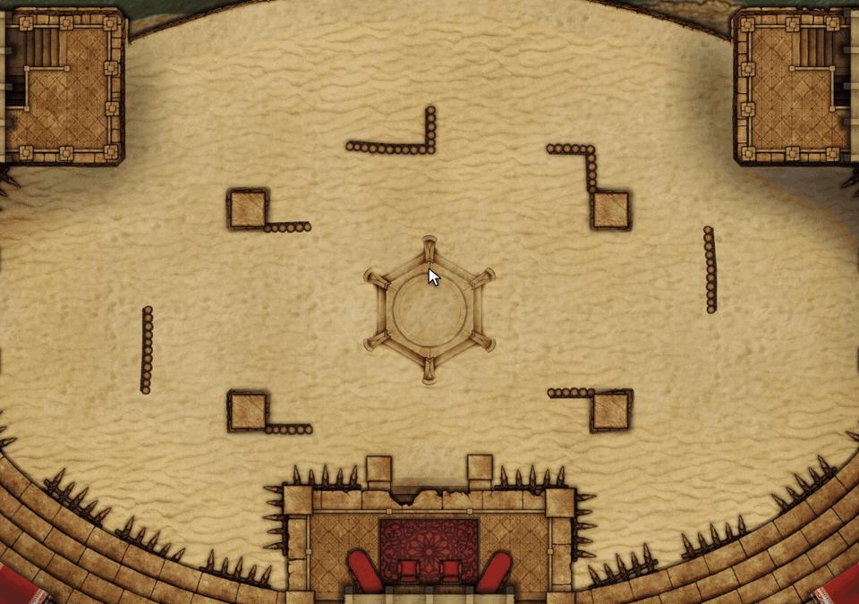

# Sephral’s Lunar Almanac

**Moons and inner realms circle above Ember, and your heroes are bound to them. When does the next full moon rise, and who is waiting for it?** Ember's calendar shows where the moons stand today. Lunar Almanac shows what comes next.

*The demo uses an invented sky with its own names, colors and moon images. In your world the almanac shows Ember's own sky.*

## Highlights

* **Every moon at a glance:** phase, influence, how long the phase lasts and when the next full moon comes. Full moons glow, and the inner realms show when each of them becomes dominant.
* **Plan ahead:** a timeline of the coming 30 days with a strip per moon, so you see at once when two moons are full together. The slow inner realms get a strip of half a year.
* **Your heroes in the sky:** every moon and realm lists the heroes of your party attuned to it, with their rank. Blessed heroes glow golden. Click a hero to open the sheet.
* **Gear that answers the moons:** items that react to a moon show a small moon next to their hero and light up while that moon is full. The GM can mark any other item too.
* **Weather at a glance:** the weather where the party is and the wind, straight from Ember. The GM also sees how the wind will turn.
* **Recharge at the full moon (D&D 5e):** an item can recover its uses at the full moon of a chosen moon or when a realm becomes dominant, right in the recovery settings of D&D 5e.
* **Never miss a full moon:** when time moves on, everyone learns which moon became full. After a long rest or a journey one message sums up everything that happened in between.
* **A calendar for the GM:** one click writes the coming full moons and dominant realms into a journal only the GM can see. The almanac itself never changes the time, the moons or the attunements.

## How it works

1. Enable the module in your Ember world.
2. Click the moon button next to the cosmos button of Ember's calendar, or the moon tool in the token controls.
3. Step to another day with the arrows next to the date to see when the next full moons come.

Players and the GM see the same sky. Players only see the heroes they are allowed to see.

## Install

Search for **Lunar Almanac** in Foundry's module browser or open the [package page](https://foundryvtt.com/packages/sephrals-lunar-almanac).

Foundry VTT 14 · Ember 0.6.3 with its adventure scenes · English and German

The almanac needs your copy of the Ember module and contains no Ember content itself. It is tested with Crucible and with Ember's D&D 5e mode.

## Learn more

Every setting and the macro API are in the [manual](MANUAL.md). Questions or ideas? Join us on [Discord](https://discord.gg/7BjCgDYaBP). Looking for more? See [all modules by Sephral](https://github.com/Sephral).

## License

See [LICENSE.md](LICENSE.md).
